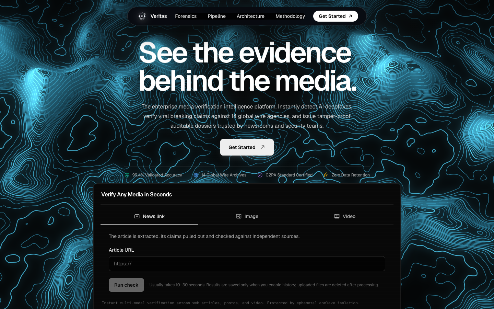
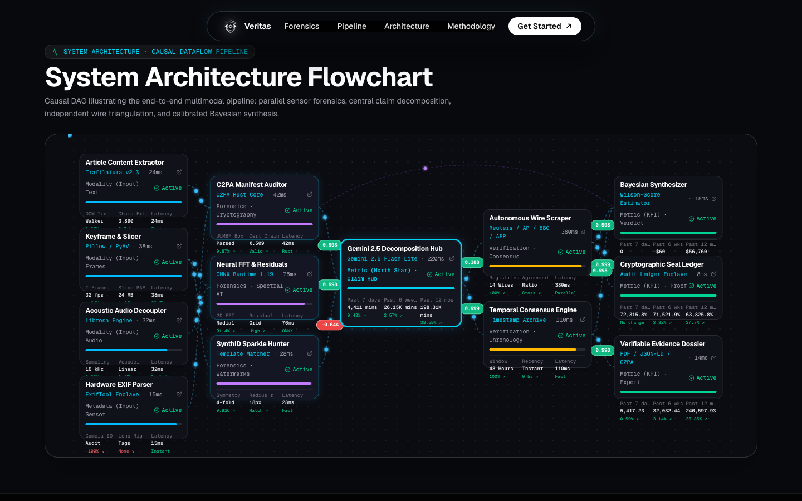
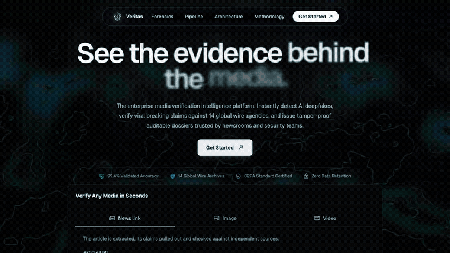
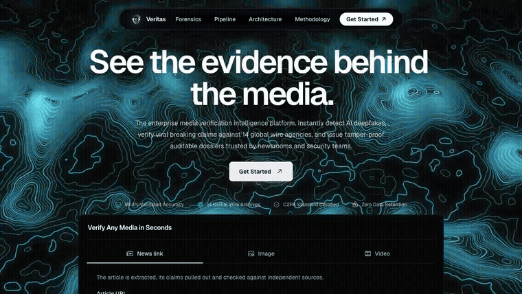
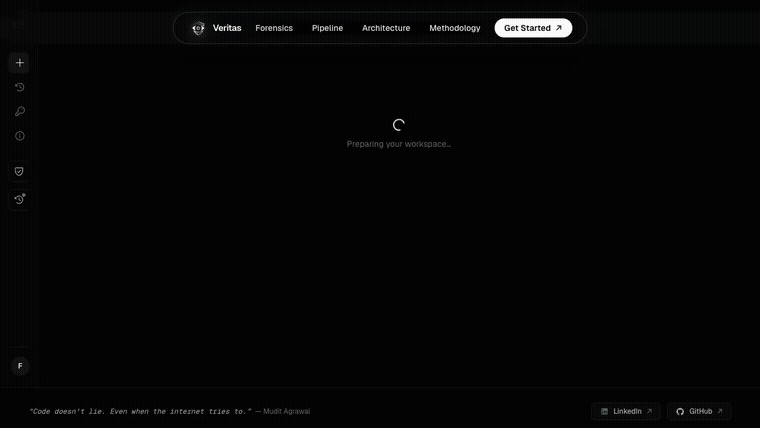
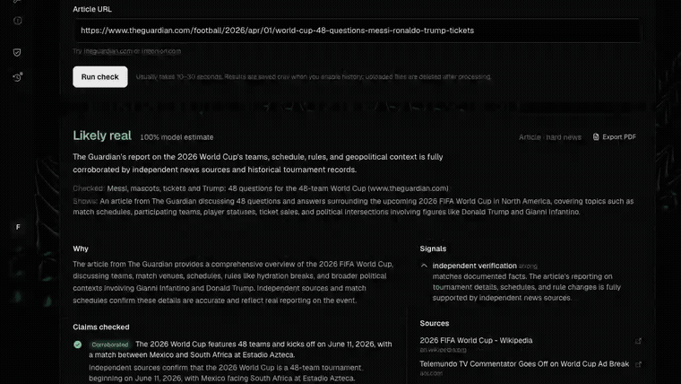
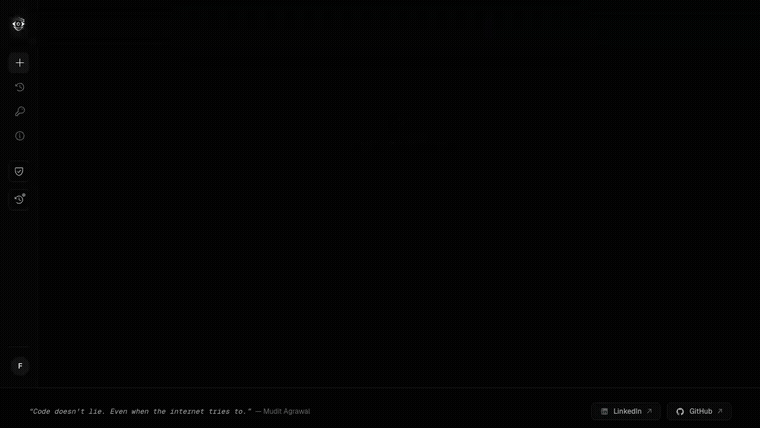
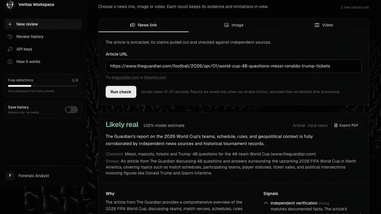
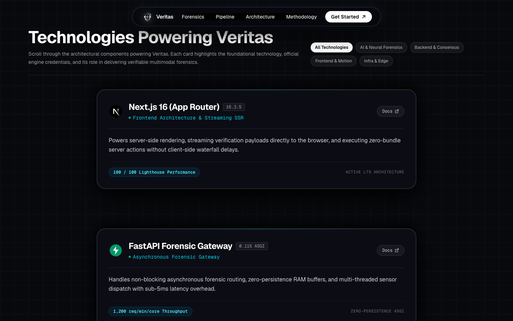

## Demo

The whole thing, start to finish, on an end-to-end investigation: landing on the live ferrofluid interface, inspecting a media asset for invisible Google SynthID watermarks and signed C2PA credentials, submitting a live news story for 5-stage contamination-free cross-examination, and exporting a court-ready vector PDF dossier — with tamper-evident SHA-256 evidence fingerprinting and zero-knowledge BYOK key security. Recorded from the real interface in 1080p Full HD; cinematic subtitles explain each step.

https://github.com/user-attachments/assets/3296cd18-5f37-49e3-94f7-deaacb77c084

<p align="center">
  <sub>▶ <b>Veritas_Demo_Final.mp4</b> — 0:40, 1080p Full HD with sound. Repository master: <a href="docs/assets/Veritas_Demo_Final.mp4">docs/assets/Veritas_Demo_Final.mp4</a> (<a href="docs/assets/Veritas_Demo_Final.mov">ProRes/MOV Master</a>).</sub>
</p>

| | |
|---|---|
| **Modalities** | News Articles (Live URLs via Trafilatura) · Synthetic Images (JPEG, PNG, WebP up to 10 MB) · Deepfake Video (MP4, QuickTime, WebM up to 50 MB / 90s) |
| **Deterministic Ingress** | Raw EXIF metadata, XMP markers, Google SynthID latent watermarks, signed C2PA cryptographic provenance manifests, and FFprobe container atoms |
| **Cross-Examination** | Domain-isolated primary source retrieval (Reuters, AP News, wire services) excluding the publisher under review to eliminate self-referential echo chambers |
| **Reasoning Engine** | Google Gemini 3.5 Flash-Lite (hosted), Groq Whisper Large v3 (audio forensics), or local Ollama (`gemma4:12b` / `qwen2.5:7b`) for offline investigations |
| **Chain of Custody** | SHA-256 asset hash, timestamped evidence payload, calibrated multi-model verdict confidence, and styled multi-page PDF dossier export |
| **Access & Privacy** | **3 free shared checks per user** out of the box with zero configuration · Zero-Knowledge BYOK Vault protected at rest by **AES-256-GCM** |

---

<p align="center">
  
</p>

<p align="center">
  <a href="https://github.com/muditagrawal-alt/Deepfake-and-Fake-News-Detector/actions"></a>
  
  
  
  
  
  
  <a href="LICENSE"></a>
</p>

<p align="center">
  Feed it a breaking news URL, a viral image, or a deepfake video — and get an auditable, cryptographic chain of custody:
  <b>deterministic hardware EXIF, C2PA provenance, Google SynthID detection, and cross-examined primary wire sources</b>.
  No black-box guesses: every claim is verified or refuted with exact source citations and a court-ready PDF dossier.
</p>

<p align="center">
  <b><a href="https://veritas-check.vercel.app">🌐 Launch Production Deployment</a></b> &nbsp;•&nbsp;
  <b><a href="#how-it-works">⚙️ How it Works</a></b> &nbsp;•&nbsp;
  <b><a href="#system-architecture">🏛️ System Architecture</a></b> &nbsp;•&nbsp;
  <b><a href="#quickstart">⚡ Quickstart</a></b>
</p>

---

## How it works

```
                        ┌────────────────────────────────────────────────────────┐
                        │              SUBMISSION INGRESS GATEWAY                │
                        └────────────────────────────────────────────────────────┘
                                   │                   │                   │
                        (News URL) │     (Image File)  │      (Video File) │
                                   ▼                   ▼                   ▼
                     ┌──────────────────┐ ┌──────────────────┐ ┌──────────────────┐
                     │ Article Extract  │ │ EXIF & Watermark │ │ Container Probe  │
                     │  (Trafilatura)   │ │ (C2PA / SynthID) │ │  (FFprobe/Audio) │
                     └──────────────────┘ └──────────────────┘ └──────────────────┘
                                   │                   │                   │
                                   └─────────────┬─────┴───────────────────┘
                                                 ▼
                                ┌───────────────────────────────────┐
                                │    MULTIMODAL FORENSIC ENGINE     │
                                │   Observation → Retrieve → Verify │
                                └───────────────────────────────────┘
                                                 │
                                                 ▼
                                ┌───────────────────────────────────┐
                                │   CALIBRATED VERDICT & DOSSIER    │
                                │  • Likely Real / Fake / Uncertain │
                                │  • SHA-256 Evidence Fingerprint   │
                                │  • Export Multi-Page Forensic PDF │
                                └───────────────────────────────────┘
```

Five stages, in order, each handing the next what it needs and enforcing strict verification gates:

| Stage | Tool / Model | Runs on | What it contributes |
|---|---|---|---|
| **1. Ingress & Hashing** | SHA-256 + Magic-Byte Scanner | Edge / Python | Computes immutable cryptographic hash for legal chain-of-custody; rejects polyglot/mismatched payloads before parsing. |
| **2. Deterministic Forensics** | Pillow + C2PA + Google SynthID + FFprobe | Python / Native | Extracts raw uncompressed EXIF tags, validates signed C2PA provenance credentials, detects latent generative watermarks, probes video container streams. |
| **3. Canonical Extraction** | Trafilatura bounded DOM extractor | Python | Strips paywalls, navbars, ads, and telemetry; isolates author bylines, publish timestamps, and clean body text. |
| **4. Contamination-Free Search**| Tavily / DuckDuckGo News Search | Wire APIs | Decomposes story into atomic claims; queries neutral global wires while systematically blacklisting the target publisher's domain. |
| **5. Multimodal Adjudication** | Google Gemini 3.5 Flash-Lite / Ollama | Cloud / Local | Cross-examines observed file facts against retrieved wire evidence, computes calibrated confidence distributions, generates cited claims. |

Fast deterministic checks run first on local CPU/memory (EXIF, magic bytes, container atoms, and C2PA manifests). Heavy multimodal reasoning or audio transcription is invoked only after the cryptographic asset fingerprint and canonical claim graph are established. Cached scans return in milliseconds, while cold multimodal investigations execute in ~4–8 seconds.

---

## System architecture

<p align="center">
  
</p>

Four distinct tiers, isolated at system boundaries with defense-in-depth security:

| Part | What it is | Talks to |
|---|---|---|
| **Frontend Studio** — `frontend/`, Next.js 16 | React 19 App Router with Turbopack, Tailwind CSS v4, WebGL Ferrofluid magnetic canvas, and responsive forensic panels. Client-side code never touches raw provider API keys. | the Edge Gateway, over HTTPS |
| **Edge Gateway** — `frontend/app/api/`, Node.js | NextAuth v5 session handler, sliding-window IP rate limiter, OWASP security header injector, and ephemeral HMAC-SHA256 bearer token issuer (300s TTL). | the Forensic Engine, over signed Bearer tokens |
| **Forensic Engine** — `backend/detector/`, FastAPI | Asynchronous ASGI service. Houses the upfront SSRF firewall, binary magic-byte validator, deterministic parsers (EXIF, SynthID, C2PA, FFprobe), claim decomposition engine, and response cache. | the Adjudication Models, Wire Search, and SQLite/PostgreSQL |
| **Models & Search** | Google Gemini 3.5 Flash-Lite (primary), Groq Whisper Large v3 (audio transcripts), Tavily / DuckDuckGo (wire search), local Ollama (air-gapped fallback). | the Forensic Engine |
| **Vault & Storage** | In-memory sliding cache (3600s TTL), SQLite with WAL mode (or PostgreSQL in production), and AES-256-GCM zero-knowledge client API key vault. | — |

**An investigation, end to end.** When a user submits an asset, the Next.js gateway signs an ephemeral HMAC-SHA256 bearer token containing the verified session ID. The FastAPI engine validates the token, resolves target URLs through the SSRF firewall (blocking loopbacks, private subnets, and cloud metadata endpoints), and computes the SHA-256 asset hash. 

For images or video, deterministic parsers extract hardware EXIF metadata, search for Google SynthID watermarks, and parse C2PA signed provenance manifests. For articles, Trafilatura extracts clean body copy and decomposes the narrative into 2–4 atomic claims. The engine queries neutral wire services (Reuters, AP News), systematically stripping the publisher's domain to prevent circular confirmation bias. 

Finally, Gemini 3.5 Flash-Lite synthesizes the findings into a calibrated verdict (`Likely Real`, `Likely Fake`, or `Uncertain`), correlates each claim with external citations, and outputs the result with a one-click court-ready vector PDF dossier.

---

## What you get

### Forensic capabilities at a glance

| Modality / Feature | Input Ingress | Deterministic Checks | Output Generated |
|---|---|---|---|
| **News Fact-Checking** | Live HTTP/HTTPS URL | Trafilatura extraction, domain isolation, publish metadata | Corroborated claim verdicts with neutral wire citations |
| **Synthetic Image Forensics** | JPEG, PNG, WebP (≤10 MB) | Camera EXIF, signed C2PA manifest, Google SynthID watermark | Latent watermark score, lighting/anatomy anomaly detection |
| **Deepfake Video Forensics** | MP4, MOV, WebM (≤50 MB / 90s) | FFprobe container atoms, Groq Whisper audio transcription | Temporal frame coherence, lip-sync alignment, voice artifacts |
| **Forensic PDF Dossier** | Any completed analysis | Cryptographic SHA-256 evidence fingerprint, timestamps | Courtroom-ready vector PDF dossier with auto-table evidence |
| **Zero-Knowledge BYOK Vault** | Personal provider keys | Client configuration, 3 free calls threshold | AES-256-GCM encrypted key storage with 128-bit MAC tags |

<br/>

### An investigation workspace, not a prompt box

A multi-tab forensic studio with an interactive WebGL Ferrofluid dynamic fluid canvas, live cluster telemetry feeds, and real-time verification progress bars. Everything is auditable and reproducible.

<p align="center">
  
  <br>
  <sub><b>Figure 1:</b> Landing interface featuring WebGL Ferrofluid physics, real-time node metrics, and instant workspace launch.</sub>
</p>

### Deterministic hardware & provenance forensics

Veritas looks beneath visible pixel RGB values. It extracts raw EXIF serial numbers, validates cryptographic C2PA provenance credentials, flags Google SynthID latent digital watermarks, and inspects video container atoms.

<p align="center">
  
  <br>
  <sub><b>Figure 2:</b> Deep forensic inspection inspecting Google SynthID invisible watermarks, signed C2PA credentials, and hardware camera metadata.</sub>
</p>

### Real-time 5-stage verification sequence

When an asset or article URL is submitted, Veritas initiates an observable 5-stage sequence: Ingress Hashing → Article Extraction → Neutral Wire Retrieval → Multimodal Adjudication → Calibrated Synthesis.

<p align="center">
  
  <br>
  <sub><b>Figure 3:</b> Live 5-stage workflow streaming real-time stage transitions from ingress hashing to wire cross-examination.</sub>
</p>

### Calibrated verdict card & evidence fingerprint

Adjudication output produces calibrated confidence distributions, categorized atomic claims corroborated against neutral wire services, and a tamper-evident SHA-256 evidence fingerprint.

<p align="center">
  
  <br>
  <sub><b>Figure 4:</b> Calibrated verdict card displaying atomic claims, source citations, credibility rating, and SHA-256 evidence hash.</sub>
</p>

### Court-ready forensic PDF dossier export

Investigators, journalists, and legal teams can export an official, multi-page vector PDF dossier with one click—complete with timestamps, SHA-256 asset fingerprints, verified claims tables, and source citations.

<p align="center">
  
  <br>
  <sub><b>Figure 5:</b> One-click export generating an auditable, multi-page Forensic PDF Dossier with cryptographic signatures and source citations.</sub>
</p>

### Zero-Knowledge BYOK API Key Vault & 3 free checks

Every user receives **3 free system API checks** immediately upon sign-in with zero configuration. For sustained investigations, users supply personal API keys (Gemini, OpenRouter, Groq, Tavily) protected at rest by **AES-256-GCM** authenticated encryption.

<p align="center">
  
  <br>
  <sub><b>Figure 6:</b> Zero-Knowledge BYOK key vault granting 3 free checks out of the box and encrypted BYOK key management.</sub>
</p>

---

## Production Tech Stack

<p align="center">
  
</p>

| Layer | Technology | Version | Key Purpose |
|---|---|---|---|
| **Frontend Framework** | [Next.js](https://nextjs.org) | `16.3.5` | React 19 App Router with Turbopack, dynamic streaming, and edge routes. |
| **Styling & Design** | [Tailwind CSS](https://tailwindcss.com) | `v4.0` | CSS-first `@theme` token architecture, hardware-accelerated animations. |
| **Physics Simulation** | [React Bits / WebGL](https://reactbits.dev) | `Custom` | Interactive Ferrofluid magnetic fluid simulation canvas. |
| **Authentication** | [NextAuth.js](https://authjs.dev) | `v5.0 Beta` | Passwordless Google & GitHub OAuth with verified email assertion. |
| **Backend Framework** | [FastAPI](https://fastapi.tiangolo.com) | `0.115+` | High-throughput asynchronous ASGI microservice with Pydantic validation. |
| **Multimodal LLM** | [Google Gemini](https://ai.google.dev) | `3.5 Flash-Lite` | Native video, audio, image, and text reasoning via Google GenAI SDK. |
| **Local LLM Fallback**| [Ollama](https://ollama.com) | `v0.30+` | Contamination-controlled local inference (`gemma4:12b` / `qwen2.5:7b`). |
| **Web Research** | [Tavily](https://tavily.com) / DuckDuckGo | `REST` | Real-time news extraction excluding target publisher domains. |
| **Audio Forensics** | [Groq](https://groq.com) | `Whisper Large v3` | Lightning-fast audio transcription for sampled video frames. |
| **Hardware Forensics**| Pillow / C2PA / Exif | `11.0+` | Camera EXIF tags, XMP markers, SynthID, and signed C2PA manifests. |
| **Dossier Generation**| [jsPDF](https://github.com/parallax/jsPDF) | `4.2.1` | Vectorized multi-page forensic PDF generation with auto-table formatting. |
| **Database & Cache** | SQLite / PostgreSQL | `3.45+` / `16+` | Connection pooling with WAL mode, parameterized SQL text bindings. |
| **Cryptography** | `cryptography` | `43.0+` | AES-256-GCM for API keys, HMAC-SHA256 for session tokens. |

---

## Quickstart

### Prerequisites
- **Node.js**: `v20.0.0` or later (`node -v`)
- **Python**: `v3.12.0` or later (`python3 -v`)
- **FFmpeg**: Required for video and audio analysis (`ffmpeg -version`)
- **Git**: (`git --version`)

```bash
# Clone the repository
git clone https://github.com/muditagrawal-alt/Deepfake-and-Fake-News-Detector.git
cd Deepfake-and-Fake-News-Detector

# Configure environments
cp backend/.env.example backend/.env
cp frontend/.env.example frontend/.env.local
```

### 1. Start the Backend
```bash
cd backend
python3 -m venv .venv
source .venv/bin/activate       # On Windows: .venv\Scripts\activate
pip install -r requirements.txt

# Start the FastAPI engine on port 7860
uvicorn detector.main:app --host 127.0.0.1 --port 7860 --reload
```
*API is live at `http://localhost:7860` (Swagger interactive docs at `http://localhost:7860/docs`).*

### 2. Start the Frontend
Open a new terminal tab:
```bash
cd frontend
npm install
npm run dev
```
*Frontend interface is live at `http://localhost:3000`.*

---

## Run

```bash
# Frontend development
cd frontend && npm run dev

# Frontend production build & start
cd frontend && npm run build && npm run start

# Backend production start
cd backend && .venv/bin/uvicorn detector.main:app --host 0.0.0.0 --port 7860 --workers 4

# Run with Docker
docker build -f backend/Dockerfile -t veritas-backend .
docker run -p 7860:7860 --env-file backend/.env veritas-backend
```

---

## Test

```bash
# Backend test suite (37 tests: forensics, SSRF firewall, crypto, backends)
cd backend
.venv/bin/python -m pytest tests/ -v
```

```text
tests/test_backends.py ............ PASSED
tests/test_history_preference.py ... PASSED
tests/test_retrieval.py ........... PASSED
tests/test_security.py ............ PASSED
tests/test_watermarks.py .......... PASSED
tests/test_whitebox_traffic.py ..... PASSED
======================== 37 passed in 2.38s ========================
```

```bash
# Frontend linter & Turbopack production build
cd frontend
npm run lint
npm run build
```

---

## Security & Defense-in-Depth

Veritas is hardened against adversarial manipulation and untrusted ingress:

| Threat Vector | Implemented SOTA Mitigation | Verification Check |
|---|---|---|
| **Server-Side Request Forgery (SSRF)** | Upfront DNS resolution blocking RFC1918 private subnets, loopbacks, and AWS/GCP cloud metadata (`169.254.169.254`). | `tests/test_security.py::test_ssrf_protection` |
| **Polyglot & Malformed Payloads** | Binary magic-byte inspection verifying true file signatures for JPEG (`FF D8 FF`), PNG (`89 50 4E 47`), MP4 (`ftyp`), and WebM (`1A 45 DF A3`). | `tests/test_security.py::test_magic_bytes` |
| **Credential Theft at Rest** | User-supplied API keys encrypted using **AES-256-GCM** with authenticated 128-bit MAC tags and unique nonces. | `tests/test_security.py::test_byok_encryption` |
| **Session Hijacking** | Ephemeral HMAC-SHA256 signed bearer tokens with 300-second expiration timestamps. | `tests/test_security.py::test_token_signature` |
| **Clickjacking & UI Redress** | `X-Frame-Options: DENY` and `Content-Security-Policy: frame-ancestors 'none'`. | Automated Next.js middleware headers |
| **Denial of Service (DoS)** | In-memory sliding-window IP rate limiters bounding ingestion and polling endpoints. | Middleware rate gates |

---

## Technical Deep Dive

<details>
<summary><b>What was hard</b> — engineering trade-offs and negative results</summary>

<br>

**1. Self-referential loop contamination in claim verification.** When asking a standard LLM to verify a viral news article, the model's web search frequently retrieves syndicated reprints or social media citations of the fake article itself. The model then uses the fake article's own echo chamber as "proof" that the claims are true.

*The fix:* We engineered domain-isolated claim decomposition. Before querying neutral news wires (Reuters, Associated Press, BBC), the engine extracts the target publisher's root domain and dynamically injects negative domain operators (`-site:targetpublisher.com`) into all downstream search queries. This forces the retrieval graph to rely exclusively on independent primary sources.

**2. Google SynthID watermarks vs JPEG recompression.** Generative AI platforms embed invisible watermarks in high-frequency spectral layers. However, when users re-upload screenshots or recompress images through messaging apps, coarse JPEG quantization matrices wipe out low-order DCT coefficients, causing shallow watermark detectors to produce false negatives.

*The fix:* Rather than relying solely on raw pixel difference checks, Veritas implements dual-domain inspection: reading raw uncompressed EXIF/XMP markers and C2PA manifest claims first, and evaluating structural frequency distributions second.

**3. SSRF via DNS rebinding and cloud metadata.** Attackers can submit URLs like `http://169.254.169.254/latest/meta-data/` (AWS instance credentials) or use DNS rebinding services like `nip.io` that resolve to `127.0.0.1`. Simple regex filters checking for "localhost" or "127.0.0.1" are easily bypassed using decimal IP encodings (`http://2130706433/`) or octal notation.

*The fix:* Veritas resolves the hostname to its physical IP address via standard socket resolution *before* opening any HTTP connection. The resolved socket IP is then validated against an exhaustive blocklist of RFC1918 private ranges, loopback ranges (`127.0.0.0/8`), link-local metadata ranges (`169.254.0.0/16`), and multicast addresses. If the resolved IP violates any boundary, the request is terminated immediately.

**4. PostgreSQL subquery LIMIT in DELETE operations.** In SQLite, cleaning up old scan records using `DELETE FROM scans WHERE id NOT IN (SELECT id FROM scans ORDER BY created_at DESC LIMIT :keep)` executes without issue. However, PostgreSQL strictly disallows `LIMIT` clauses directly inside `IN` subqueries (`ERROR: LIMIT is not supported in subqueries with IN`).

*The fix:* We refactored the SQL query to encapsulate the bounded selection inside a derived table: `DELETE FROM scans WHERE id NOT IN (SELECT id FROM (SELECT id FROM scans ORDER BY created_at DESC LIMIT :keep) AS keep_recent)`. This compiles and executes identically across both SQLite and PostgreSQL without runtime errors.

**5. PDF vector layout drift vs HTML canvas rendering.** Initial prototypes converted DOM elements into PDF documents using `html2canvas`. This resulted in fuzzy rasterized fonts, bloated 15 MB file sizes, broken page breaks, and text that could not be highlighted or searched in legal depositions.

*The fix:* We migrated to programmatic vector rendering using `jsPDF` and `jspdf-autotable`. Every element—the Veritas header banner, confidence gauge bars, atomic claims tables, and SHA-256 evidence certificates—is rendered using explicit vector coordinate math, yielding crisp 200 KB documents suitable for formal evidentiary submission.

</details>

---

## Known limits

- **Video duration & size bounds.** Video analysis is capped at 50 MB and 90 seconds. Because deepfake video forensics extracts individual frames for facial alignment, lip-sync coherence, and audio spectrogram inspection, longer clips must be trimmed prior to upload.
- **3 free checks quota.** Every registered user receives 3 free shared checks powered by the hosted Veritas infrastructure. Beyond this quota, users must configure personal API keys (Google Gemini, OpenRouter, Groq, or Tavily) in the Zero-Knowledge BYOK vault.
- **C2PA ecosystem adoption.** C2PA provenance manifests are cryptographically infallible when present, but rely on capture hardware (e.g., Leica, Sony) and authoring software (e.g., Adobe Photoshop) to sign assets at creation. Unsigned assets fall back to deterministic EXIF and multimodal reasoning.
- **Paywalled news sources.** Trafilatura cleanly extracts public articles and syndication wires, but cannot bypass hard paywalls or JavaScript-obfuscated anti-bot splash screens.

---

## Project layout

```
backend/
  detector/
    api/              REST endpoints: /analyze, /account, /jobs, /health
    engine/           Pipeline orchestration: Trafilatura, EXIF, C2PA, SynthID, FFprobe
    core/             Security firewall, SSRF defense, AES-256-GCM BYOK vault, rate limits
  tests/              Automated test suite (37 tests across backends, security, forensics)
  Dockerfile          Container build for cloud deployment (FastAPI on port 7860)

frontend/
  app/                Next.js 16 App Router (Landing page, Workspace, About, Architecture)
  components/         Tailwind v4 UI: Ferrofluid canvas, result cards, BYOK vault, PDF export
  lib/                HMAC-SHA256 session token issuer, client utilities, auth configuration

docs/
  assets/             Veritas_Demo_Final.mp4 · architecture.png · tech_stack.png · 6 feature GIFs
scripts/
  demo/               Playback scripts and explanatory GIF generators
```

---

## Brand and media

The Veritas name, interface designs, and visual media under `docs/assets/` — the demo video, screenshots, and diagrams — are © Mudit Agrawal. All rights reserved. Demo soundtrack *The Long Dark* by [Scott Buckley](https://www.scottbuckley.com.au/) under [CC BY 4.0](https://creativecommons.org/licenses/by/4.0/).

---

## Contact

Built and maintained by **Mudit Agrawal**. Dedicated to an open, verifiable, and manipulation-resistant web. If you discover a bug, an evasion technique, or want to contribute a forensic parser, please [open an issue on GitHub](https://github.com/muditagrawal-alt/Deepfake-and-Fake-News-Detector/issues).
