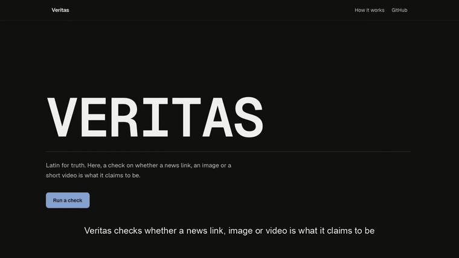
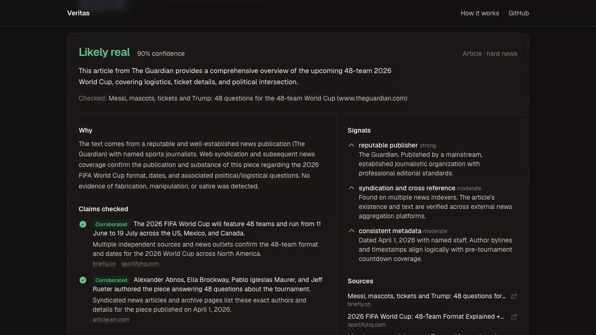
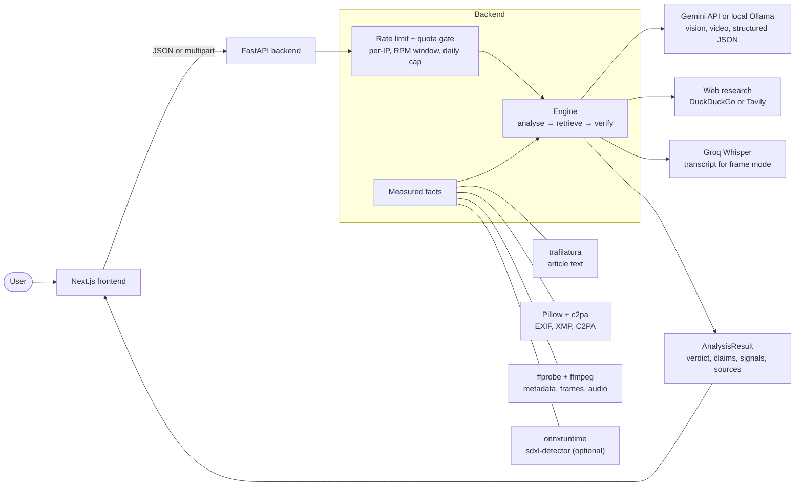
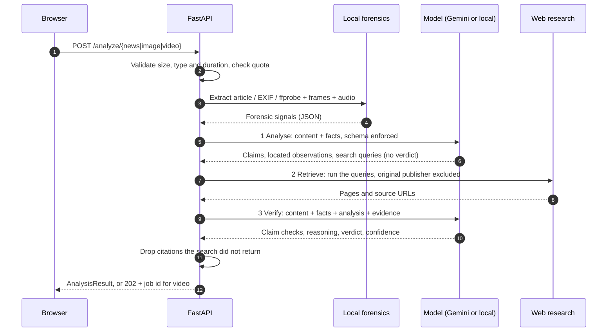

<div align="center">

# Veritas

**Is it real?** A multimodal misinformation checker for news links, images and short videos.
It returns a verdict, a calibrated confidence, the individual claims it checked, and the sources behind them.

**[Try it live](https://veritas-check.vercel.app)** · [Quick start](#quick-start) · [Architecture](#architecture) · [API](#api) · [Results](#results)

<sub>The backend runs on a free instance that sleeps when idle, so the first check of the day takes about a minute to wake.</sub>

</div>

<p align="center">
  <a href="docs/assets/demo.mp4"></a><br>
  <a href="docs/assets/demo.mp4"><b>Watch the full demo</b></a> (30s, recorded against the live deployment)
</p>

---

## What it does

Paste a news URL, or upload an image or a short video. Veritas reads **measured file facts**
(EXIF, XMP, C2PA content credentials, container metadata) and hands them, with the content
itself, to a **model that reports the claims and observations, then judges them against
independent evidence** retrieved from the web. It shows its work: every claim, every source,
and everything it could not verify. No hand-written rule decides or adjusts a verdict.

| Input | What happens |
|---|---|
| **News URL** | Article extracted; genre and 2-4 atomic claims identified; each claim judged against pages retrieved from sources other than the original publisher |
| **Image** | EXIF, XMP and C2PA facts read (signed AI-generation credentials are verifiable); the image described, OCRed and checked for details inconsistent with a real photograph; depicted people, events and captions checked on the web |
| **Video** | ffprobe and C2PA facts read; the clip analysed with its audio (or as frames plus a transcript on a local model): motion, lip sync, on-screen text and spoken claims |

**The deployed service runs no local deep-learning model.** No PyTorch, no transformers, no BERT.
The container is a few hundred MB and cold-starts in seconds, which is what makes it
deployable on free infrastructure. For research runs the same engine can use a local
vision-language model through [Ollama](https://ollama.com) (`LLM_ENGINE=ollama`, default
`gemma4:12b`), so benchmarks do not depend on hosted-API quota.

<p align="center">
  
</p>

---

## Architecture



**Why this split:** the frontend is fully static, uploads go straight to the API
rather than through it, and the model keys never leave the backend.

## Execution flow



Video runs asynchronously: the client gets a `job_id` and polls `/jobs/{id}`, which reports
the live stage (`sampling frames`, `uploading`, `verifying claims on the web`).

---

## Quick start

### Prerequisites

| Requirement | Notes |
|---|---|
| Python 3.11+ | Backend |
| Node.js 20+ | Frontend |
| ffmpeg and ffprobe | `brew install ffmpeg` / `apt install ffmpeg`. Needed for video |
| Gemini API key | Free at [aistudio.google.com/apikey](https://aistudio.google.com/apikey) |
| Groq API key (optional) | Free at [console.groq.com/keys](https://console.groq.com/keys). Whisper transcript fallback |
| Tavily API key (optional) | Free at [app.tavily.com](https://app.tavily.com). Faster, more reliable search than the default |

### 1. Clone and configure

```bash
git clone https://github.com/muditagrawal-alt/Deepfake-and-Fake-News-Detector.git
cd Deepfake-and-Fake-News-Detector
cp backend/.env.example .env
```

Open `.env` and fill in at least `GEMINI_API_KEY`. The file is git-ignored.

```ini
GEMINI_API_KEY=your-key-here
GROQ_API_KEY=
TAVILY_API_KEY=
```

### 2. Backend

```bash
cd backend
python3 -m venv .venv && source .venv/bin/activate
pip install -r requirements.txt
uvicorn detector.main:app --reload --port 7860
```

First run downloads the 354 MB ONNX detector into `backend/models/`. Verify:

```bash
curl -s localhost:7860/health
```

### 3. Frontend

```bash
cd frontend
npm install
npm run dev
```

Open <http://localhost:3000>. `frontend/.env.local` points at `http://localhost:7860` by default.

### Command line, without the UI

```bash
cd backend && source .venv/bin/activate
python -m scripts.list_models                       # Gemini model ids your key can call
python -m scripts.smoke --url https://example.com/article
python -m scripts.smoke --image path/to/photo.jpg
python -m scripts.smoke --video path/to/clip.mp4
```

### Reproduce the benchmarks

```bash
python -m eval.run_eval --modality news     # also: image, video
```

Writes `data/evaluation/<set>/results_v2.csv` and `metrics_v2.txt`.

---

## API

Base URL is the backend origin (`https://veritas-api-ahjc.onrender.com` for the live
deployment). All responses are JSON.

| Method | Endpoint | Body | Returns |
|---|---|---|---|
| `GET` | `/health` | | Provider status, model ids, remaining quota |
| `POST` | `/analyze/news` | `{"url": "..."}` | `AnalysisResult` |
| `POST` | `/analyze/image` | multipart `file` | `AnalysisResult` |
| `POST` | `/analyze/video` | multipart `file` | `202 {"job_id"}` |
| `GET` | `/jobs/{job_id}` | | `{status, stage, result}` |

<details>
<summary><code>AnalysisResult</code> shape</summary>

```jsonc
{
  "verdict": "LIKELY_REAL | LIKELY_FAKE | UNCERTAIN",
  "confidence": 0.92,
  "summary": "One or two plain sentences.",
  "reasoning": "How the evidence was weighed.",
  "genre": "satire",
  "claims": [{
    "claim": "...",
    "status": "corroborated | contradicted | misleading | unverifiable",
    "explanation": "...",
    "sources": [{"title": "...", "url": "..."}]
  }],
  "signals": [{"name": "generator_metadata", "value": "encoder: Google",
               "direction": "fake", "weight": "strong", "note": "..."}],
  "caveats": ["What could not be verified."],
  "evidence": [{"title": "...", "url": "..."}],
  "forensics": { "metadata": {}, "frame_detector": {} },
  "provenance": {"model": "gemini-3.5-flash-lite", "grounded": false,
                 "research_provider": "duckduckgo"}
}
```
</details>

```bash
curl -s -X POST localhost:7860/analyze/news \
  -H 'content-type: application/json' \
  -d '{"url":"https://www.theonion.com/report-nation-somehow-more-divided-than-ever-before-1849972712"}'
```

---

## Results

> **Status: under re-evaluation.** An audit of the original benchmark sets
> (`research/docs/01_legacy_analysis.md`) found that each carries a label
> shortcut: image resolution alone separates the image set at 0.92, clip
> duration alone separates the video set at 0.97, generator metadata tags
> identify every fake video, and every fake news item comes from one of two
> satire domains, 24 of whose 25 URLs no longer resolve to an article. The
> numbers below are therefore **development measurements,
> not evidence of detection performance**. Evaluation on established
> benchmarks, with controls for these shortcuts, is in progress; see
> [`research/IMPLEMENTATION_PLAN.md`](research/IMPLEMENTATION_PLAN.md).

On the original 130-item sets, with 95% intervals:

| Set | v1 | v2 | Difference significant? |
|---|---|---|---|
| News (50) | 0.86 [0.74, 0.93] | 0.92 [0.81, 0.97] | no (McNemar p = 0.51) |
| Images (50) | 0.86 [0.74, 0.93] | 0.96 [0.86, 0.99] | no (p = 0.18) |
| Videos (30) | 1.00 [0.89, 1.00] | 1.00 [0.89, 1.00] | n/a |

With the shortcuts controlled, v1 falls to **0.76** on images (size features
removed) and **0.63** on video (metadata removed, frames bit-identical;
p = 0.001). The engine has since been rebuilt without hand-written decision
rules (`research/docs/03_v2_research_log.md`); controlled runs of the rebuilt
engine replace the v2 column. Every figure, table and per-item
result is regenerated by the scripts in `research/scripts/`.

**On the pixel detector.** The bundled `sdxl-detector` is **off by default**.
On the image set, v2 scored 0.96 without it and 0.88 with it, a difference
that is not statistically significant at this size (p = 0.13); on its own the
detector scores 0.66. It also needs about 500 MB resident, so leaving it off is
what lets the service run on a small instance. Set `ENABLE_ONNX_DETECTOR=true`
to include it.

---

## Project structure

```
backend/
  detector/
    main.py              FastAPI app, endpoints, limits
    pipeline.py          Dispatcher and legacy-compatible entry point
    config.py            Settings from .env
    quota.py             Concurrency, RPM window, daily cap
    engine/              analyse -> retrieve -> verify; Gemini and Ollama backends
    analyzers/           news.py, image.py, video.py, prompts.py
    forensics/           article, exif, video_meta, provenance (C2PA), frames, onnx_detector
    providers/           gemini, groq, research, openai_compat
  eval/run_eval.py       Benchmark runner
  Dockerfile             Space image
frontend/                Next.js app (App Router, Tailwind v4, Motion)
data/evaluation/         Benchmark sets and results
research/                Paper revision: audit, plan, scripts, runs, results, figures
paper/                   Figure generation for the original submission
```

---

## Limitations

- Verdicts are probabilistic estimates from a language model. They are **signals, not proof**.
- Metadata is easily stripped or edited, and most authentic media online carries none. C2PA credentials are signed, but a re-upload usually removes them.
- The optional pixel detector (off by default) was trained on SDXL-era images; its score is passed to the model as a measured fact.
- Paywalled or bot-blocked articles fall back to URL-based checks, which lowers confidence.
- Free-tier model providers may use submitted content to improve their services. Do not submit private material.

## License and credits

Code in this repository is released under the MIT License. The bundled detector,
[`Organika/sdxl-detector`](https://huggingface.co/Organika/sdxl-detector), is **CC-BY-NC-3.0**,
so any deployment of this project as a whole must remain non-commercial.

Background music in the demo: **"Art Of Silence V2"** by Uniq, licensed
[CC BY 4.0](https://creativecommons.org/licenses/by/4.0), via
[Wikimedia Commons](https://commons.wikimedia.org/wiki/File:Uniq_-_Art_Of_Silence_V2.ogg).
The excerpt used is `docs/assets/music.mp3`.

Built by [Mudit Agrawal](https://github.com/muditagrawal-alt) as a Semester-6 major project.
