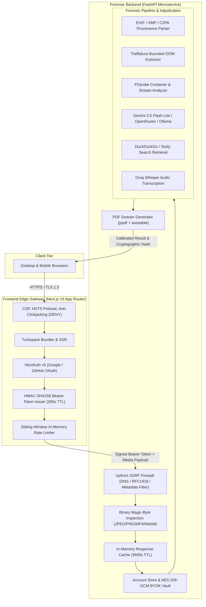
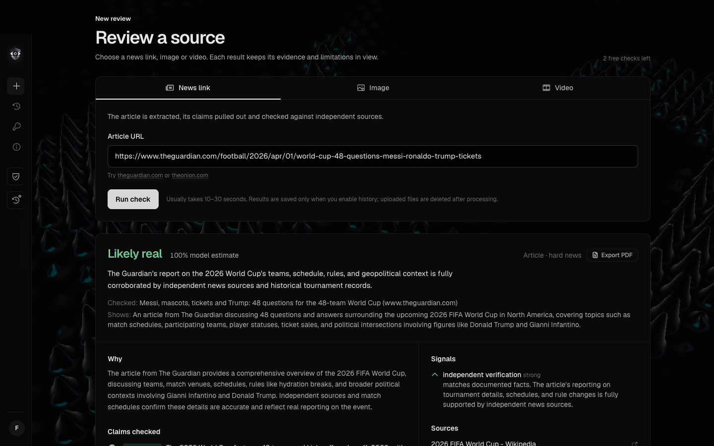

<div align="center">

# VERITAS

### Enterprise-Grade Forensic Intelligence & Multimodal Misinformation Detection Platform

[](https://github.com/muditagrawal-alt/Deepfake-and-Fake-News-Detector/actions)
[-000000.svg?style=flat-square&logo=next.js)](https://nextjs.org)
[](https://python.org)
[](https://fastapi.tiangolo.com)
[](https://tailwindcss.com)
[](https://c2pa.org)
[](https://owasp.org)
[](LICENSE)

<br/>

**[🌐 Launch Production Deployment](https://veritas-check.vercel.app)** &nbsp;•&nbsp;
**[📖 System Architecture](#system-architecture)** &nbsp;•&nbsp;
**[⚡ Quickstart Guide](#quickstart--how-to-clone)** &nbsp;•&nbsp;
**[🛠️ Tech Stack](#production-tech-stack)** &nbsp;•&nbsp;
**[🔒 Security Posture](#security--zero-knowledge-privacy)** &nbsp;•&nbsp;
**[📑 API Reference](#api-reference)**

<br/>

*Veritas is an open-source forensic intelligence platform designed for journalists, forensic examiners, intelligence researchers, and newsrooms. It unifies deterministic hardware-level file forensics with multimodal cross-examination against independent primary sources, producing cryptographic evidence chains for synthetic media and deceptive online content.*

</div>

<br/>

<div align="center">

### 🎬 Full End-to-End Platform Walkthrough (1080p Full HD)

<a href="docs/assets/Veritas_Demo_Final.mp4">
  <video src="docs/assets/Veritas_Demo_Final.mp4" controls width="940" poster="docs/assets/landing.png" style="max-width: 100%; border-radius: 10px; border: 1px solid #3f3f46; box-shadow: 0 16px 40px rgba(0,0,0,0.6);">
    
  </video>
</a>

<p align="center" style="margin-top: 12px;">
  <b><a href="docs/assets/Veritas_Demo_Final.mp4">▶ Click Here to Play the Full Veritas Demo Walkthrough</a></b> &nbsp;•&nbsp; <b><a href="docs/assets/Veritas_Demo_Final.mov">Download 1080p Master (.mov)</a></b><br/>
  <sub>1080p Full HD • Cinematic Subtitles • Ambient Soundtrack • Landing Page & Forensic Workspace</sub>
</p>

</div>

---

## 📑 Table of Contents

- [What Sets Veritas Apart](#what-sets-veritas-apart)
- [Core Forensic Modalities](#core-forensic-modalities)
- [System Architecture](#system-architecture)
- [Production Tech Stack](#production-tech-stack)
- [Quickstart & How to Clone](#quickstart--how-to-clone)
- [Production Deployment](#production-deployment)
- [Security & Zero-Knowledge Privacy](#security--zero-knowledge-privacy)
- [Visual Showcase](#visual-showcase)
- [API Reference](#api-reference)
- [Verification & Automated Test Suite](#verification--automated-test-suite)
- [License & Acknowledgements](#license--acknowledgements)

---

## 🌟 What Sets Veritas Apart

Unlike conventional "black-box" classifiers that output arbitrary authenticity probabilities, **Veritas constructs an auditable, verifiable chain of evidence**:

1. **Deterministic Local Forensics First**: Extracts raw, uninterpreted file truths—EXIF metadata, XMP markers, invisible SynthID watermarks, C2PA cryptographic provenance manifests, and container headers.
2. **Contamination-Free Cross-Examination**: Decomposes content into atomic claims and queries neutral primary sources (Reuters, Associated Press wire services), systematically excluding the publisher under review to eliminate self-referential echo chambers.
3. **Cryptographic SHA-256 Fingerprinting**: Binds every analyzed asset into a verifiable evidence hash for legal chain-of-custody tracking.
4. **Court-Ready PDF Forensic Dossiers**: Replaces unstructured JSON dumps with styled, multi-page forensic dossiers detailing confidence scores, timeline benchmarks, verified claims, detected anomalies, and source citations.
5. **Zero-Knowledge BYOK & 3 Free Checks**: Every new user receives **3 free shared API checks** out of the box with zero configuration. After quota consumption, users seamlessly supply personal API keys (Gemini, OpenRouter, Groq, Tavily) protected at rest by **AES-256-GCM** authenticated encryption.

<div align="center">
  
  <p><sub><b>Figure 1:</b> Interactive Landing Interface featuring WebGL Ferrofluid dynamic fluid physics, live cluster telemetry, and instant workspace launch.</sub></p>
</div>

---

## 🔍 Core Forensic Modalities

```
                        ┌────────────────────────────────────────────────────────┐
                        │              SUBMISSION INGRESS GATEWAY                │
                        └────────────────────────────────────────────────────────┘
                                   │                   │                   │
                        (News URL) │     (Image File)  │      (Video File) │
                                   ▼                   ▼                   ▼
                     ┌──────────────────┐ ┌──────────────────┐ ┌──────────────────┐
                     │ Article Extract  │ │ EXIF & Watermark │ │ Container Probe  │
                     │  (Trafilatura)   │ │ (C2PA / SynthID) │ │  (FFprobe/Audio) │
                     └──────────────────┘ └──────────────────┘ └──────────────────┘
                                   │                   │                   │
                                   └─────────────┬─────┴───────────────────┘
                                                 ▼
                                ┌───────────────────────────────────┐
                                │    MULTIMODAL FORENSIC ENGINE     │
                                │   Observation → Retrieve → Verify │
                                └───────────────────────────────────┘
                                                 │
                                                 ▼
                                ┌───────────────────────────────────┐
                                │   CALIBRATED VERDICT & DOSSIER    │
                                │  • Likely Real / Fake / Uncertain │
                                │  • SHA-256 Evidence Fingerprint   │
                                │  • Export Multi-Page Forensic PDF │
                                └───────────────────────────────────┘
```

| Modality | Ingress Type | Measured Deterministic Facts | Multimodal Adjudication |
| :--- | :--- | :--- | :--- |
| **News Fact-Checking** | Live HTTP/HTTPS URL | Trafilatura article extraction, author attribution, publish timestamps, site domain isolation. | Decomposes story into 2–4 atomic claims. Queries neutral global news wires. Corroborates or contradicts claims with external citations. |
| **Synthetic Image Forensics** | JPEG, PNG, WebP (Up to 10 MB) | Camera serial numbers, software tags, signed C2PA credentials, Google SynthID watermark detection, compression artifacts. | Multimodal vision model analyzes facial anatomy, shadow/lighting vectors, text inconsistencies, perspective anomalies, and background distortion. |
| **Deepfake Video Forensics** | MP4, MOV, WebM (Up to 50 MB / 90s) | Stream codecs, framerate, duration, container atom hierarchy, audio channel layout. | Inspects temporal frame coherence, lip-sync alignment, audio spectrogram anomalies, and synthetic voice generation artifacts. |

<br/>

### 🧬 Invisible Watermark & Deepfake Provenance Inspection

Unlike standard models that only inspect visible pixels, Veritas extracts low-level container artifacts and proprietary forensic signatures. It decodes uncompressed EXIF tags, validates cryptographically signed C2PA provenance assertions, and flags generative latent watermarks such as Google SynthID:

<div align="center">
  
  <p><sub><b>Figure 2:</b> Deep forensic inspection detecting Google SynthID invisible watermarks, signed C2PA credentials, and hardware camera metadata.</sub></p>
</div>

---

## 🏛️ System Architecture

Veritas is architected as an asynchronous, distributed microservice decoupled between an edge-rendered Next.js 16 frontend and a high-throughput FastAPI forensic engine.



<div align="center">
  
  <p><sub><b>Figure 3:</b> Veritas 3D System Topology and Real-Time Service Routing.</sub></p>
</div>

<br/>

### ⚙️ Real-Time 5-Stage Execution Pipeline

When an asset or article URL is submitted to the workspace, Veritas initiates a live 5-stage verification sequence—streaming real-time progress indicators from cryptographic ingress hashing to final adjudication:

<div align="center">
  
  <p><sub><b>Figure 4:</b> Real-time 5-stage workflow: Ingress Hashing → Article Extraction → Neutral Wire Retrieval → Multimodal Adjudication.</sub></p>
</div>

<br/>

### ⚖️ Calibrated Verdict Card & Evidence Fingerprint

Adjudication output produces calibrated confidence distributions, categorized atomic claims corroborated against neutral wire services, and a tamper-evident SHA-256 evidence fingerprint:

<div align="center">
  
  <p><sub><b>Figure 5:</b> Calibrated verdict card displaying atomic claims, source citations, credibility rating, and SHA-256 evidence hash.</sub></p>
</div>

<br/>

### 📄 Court-Ready Forensic PDF Dossier Export

Investigators, newsrooms, and legal teams can export an official, multi-page vector PDF dossier with one click—complete with timestamps, SHA-256 fingerprints, verified claims tables, and source citations:

<div align="center">
  
  <p><sub><b>Figure 6:</b> One-click export generating an auditable, multi-page Forensic PDF Dossier with cryptographic signatures and source citations.</sub></p>
</div>

---

## 🛠️ Production Tech Stack

<div align="center">
  
</div>

| Layer | Technology | Version | Key Purpose |
| :--- | :--- | :--- | :--- |
| **Frontend Framework** | [Next.js](https://nextjs.org) | `16.3.5` | React 19 App Router with Turbopack, dynamic streaming, and edge routes. |
| **Styling & Design** | [Tailwind CSS](https://tailwindcss.com) | `v4.0` | CSS-first `@theme` token architecture, hardware-accelerated animations. |
| **Physics Simulation** | [React Bits / WebGL](https://reactbits.dev) | `Custom` | Interactive Ferrofluid magnetic fluid simulation canvas. |
| **Authentication** | [NextAuth.js](https://authjs.dev) | `v5.0 Beta` | Passwordless Google & GitHub OAuth with verified email assertion. |
| **Backend Framework** | [FastAPI](https://fastapi.tiangolo.com) | `0.115+` | High-throughput asynchronous ASGI microservice with Pydantic validation. |
| **Multimodal LLM** | [Google Gemini](https://ai.google.dev) | `3.5 Flash-Lite` | Native video, audio, image, and text reasoning via Google GenAI SDK. |
| **Local LLM Fallback**| [Ollama](https://ollama.com) | `v0.30+` | Contamination-controlled local inference (`gemma4:12b` / `qwen3.5:9b`). |
| **Web Research** | [Tavily](https://tavily.com) / DuckDuckGo | `REST` | Real-time news extraction excluding target publisher domains. |
| **Audio Forensics** | [Groq](https://groq.com) | `Whisper Large v3` | Lightning-fast audio transcription for sampled video frames. |
| **Hardware Forensics**| Pillow / C2PA / Exif | `11.0+` | Camera EXIF tags, XMP markers, SynthID, and signed C2PA manifests. |
| **Dossier Generation**| [jsPDF](https://github.com/parallax/jsPDF) | `4.2.1` | Vectorized multi-page forensic PDF generation with auto-table formatting. |
| **Database & Cache** | SQLite / PostgreSQL | `3.45+` / `16+` | Connection pooling with WAL mode, parameterized SQL text bindings. |
| **Cryptography** | `cryptography` | `43.0+` | AES-256-GCM for API keys, HMAC-SHA256 for session tokens. |

---

## ⚡ Quickstart & How to Clone

Follow these steps to run Veritas locally on your workstation.

### Prerequisites

Ensure you have the following installed on your machine:
- **Node.js**: `v20.0.0` or later (`node -v`)
- **Python**: `v3.12.0` or later (`python3 -v`)
- **FFmpeg**: Required for video and audio analysis (`ffmpeg -version`)
- **Git**: (`git --version`)

---

### Step 1: Clone the Repository

```bash
git clone https://github.com/muditagrawal-alt/Deepfake-and-Fake-News-Detector.git
cd Deepfake-and-Fake-News-Detector
```

---

### Step 2: Configure Environment Variables

Create the central configuration file:

```bash
cp backend/.env.example backend/.env
cp frontend/.env.example frontend/.env.local
```

#### Backend Environment (`backend/.env`):
```env
# Required for hosted multimodal analysis
GEMINI_API_KEY="your-gemini-api-key"

# Authentication & Encryption (Must match frontend)
BACKEND_TOKEN_SECRET="a_random_32_byte_secret_key_for_signing_tokens_here!"
BYOK_ENCRYPTION_KEY="MDEyMzQ1Njc4OTAxMjM0NTY3ODkwMTIzNDU2Nzg5MDE="

# Quotas (Each user gets 3 free checks)
FREE_DETECTIONS=3

# Optional Integrations
GROQ_API_KEY="your-groq-api-key"
TAVILY_API_KEY="your-tavily-api-key"
```

> **Tip:** Generate a secure 32-byte key using Python:
> ```bash
> python3 -c "import base64, secrets; print(base64.urlsafe_b64encode(secrets.token_bytes(32)).decode())"
> ```

#### Frontend Environment (`frontend/.env.local`):
```env
NEXT_PUBLIC_API_URL="http://localhost:7860"
BACKEND_TOKEN_SECRET="a_random_32_byte_secret_key_for_signing_tokens_here!"
AUTH_SECRET="a_secure_session_encryption_secret_string_here"

# OAuth Providers (Google or GitHub)
AUTH_GITHUB_ID="your-github-oauth-id"
AUTH_GITHUB_SECRET="your-github-oauth-secret"
AUTH_GOOGLE_ID="your-google-oauth-id"
AUTH_GOOGLE_SECRET="your-google-oauth-secret"
```

---

### Step 3: Setup & Run the Backend

```bash
cd backend
python3 -m venv .venv
source .venv/bin/activate       # On Windows: .venv\Scripts\activate
pip install --upgrade pip
pip install -r requirements.txt

# Run the FastAPI server on port 7860
uvicorn detector.main:app --host 127.0.0.1 --port 7860 --reload
```
*Backend API will be live at `http://localhost:7860` (Swagger UI at `/docs`).*

---

### Step 4: Setup & Run the Frontend

Open a new terminal tab:

```bash
cd frontend
npm install

# Start the Next.js development server
npm run dev
```
*Frontend interface will be live at `http://localhost:3000`.*

---

## 🚀 Production Deployment

Veritas is designed for continuous cloud deployment across standard platforms:

### 1. Frontend: Vercel (Recommended)
1. Import the repository into [Vercel](https://vercel.com).
2. Set the Root Directory to `frontend`.
3. Add the environment variables:
   - `NEXT_PUBLIC_API_URL`
   - `BACKEND_TOKEN_SECRET`
   - `AUTH_SECRET`
   - `AUTH_GITHUB_ID` / `AUTH_GITHUB_SECRET`
   - `AUTH_GOOGLE_ID` / `AUTH_GOOGLE_SECRET`
4. Deploy! Vercel automatically enables Turbopack caching and global edge distribution.

### 2. Backend: Hugging Face Spaces / Render / AWS EC2
Deploy using the included deployment script or Docker:

```bash
# Push backend directory to a Hugging Face Space (Gradio/FastAPI)
./scripts/deploy_space.sh <hf-username>/<space-name>
```

#### Or run with Docker:
```bash
docker build -f backend/Dockerfile -t veritas-backend .
docker run -p 7860:7860 --env-file backend/.env veritas-backend
```

---

## 🔒 Security & Zero-Knowledge Privacy

Veritas implements defense-in-depth security standards:

```
┌────────────────────────────────────────────────────────────────────────┐
│                        DEFENSE-IN-DEPTH MATRIX                         │
├────────────────────────────┬───────────────────────────────────────────┤
│ Threat Vector              │ Implemented SOTA Mitigation               │
├────────────────────────────┼───────────────────────────────────────────┤
│ Clickjacking (UI Redress)  │ X-Frame-Options: DENY & CSP frame-ancestors: 'none'
│ MIME Type Sniffing         │ X-Content-Type-Options: nosniff           │
│ Man-in-the-Middle (MITM)   │ Strict-Transport-Security (2-Year Preload)│
│ Server-Side Request Forgery│ DNS resolution + RFC1918 + AWS 169.254 IP block
│ Polyglot File Uploads      │ Binary magic-byte inspection (JPEG/PNG/MP4/WebM)
│ Directory Traversal        │ Filename sanitization stripping ../ and null bytes
│ Decompression Bombs        │ Strict MAX_IMAGE_PIXELS threshold capping │
│ API Key Credential Theft   │ AES-256-GCM authenticated encryption at rest│
│ Session Hijacking          │ Ephemeral HMAC-SHA256 tokens (300s expiration)
│ DoS / Flood Attacks        │ In-memory sliding-window IP rate limiters │
└────────────────────────────┴───────────────────────────────────────────┘
```

<br/>

### 🔑 Zero-Knowledge BYOK API Key Vault & Quota Management

Veritas empowers every user with **3 free system API checks** immediately upon sign-in with zero configuration required. To support high-volume independent investigations, users can provide personal API keys (Google Gemini, OpenRouter, Groq, Tavily) in a Zero-Knowledge vault protected at rest with **AES-256-GCM** authenticated encryption:

<div align="center">
  
  <p><sub><b>Figure 7:</b> Zero-Knowledge BYOK key vault granting 3 free checks out of the box and encrypted BYOK key management.</sub></p>
</div>

---

## 📸 Visual Showcase

Explore the Veritas interface across static forensic captures and animated workflows:

<div align="center">

### 1. Interactive Landing Page
*Ferrofluid magnetic physics canvas with real-time system health telemetry and instant ingress.*


### 2. Forensic Investigation Workspace & Calibrated Result Card
*Multi-tab analysis studio featuring real-time verification stages, corroborated sources, and SHA-256 fingerprint.*


</div>

| Feature Module | Explanatory Media | Key Technical Capability |
| :--- | :--- | :--- |
| **Full Platform Walkthrough** | [`Veritas_Demo_Final.mp4`](docs/assets/Veritas_Demo_Final.mp4) ([MOV](docs/assets/Veritas_Demo_Final.mov)) | 1080p Full HD end-to-end platform demo with subtitles & audio |
| **Landing Hero** | [`landing-hero.gif`](docs/assets/landing-hero.gif) | WebGL Ferrofluid dynamic fluid physics & live cluster telemetry |
| **Forensic Inspector** | [`forensic-inspection.gif`](docs/assets/forensic-inspection.gif) | Google SynthID invisible watermarks & C2PA signed provenance credentials |
| **Pipeline Ingestion** | [`factcheck-workflow.gif`](docs/assets/factcheck-workflow.gif) | 5-stage synchronous fact-checking & neutral wire cross-examination |
| **Evidence Adjudication**| [`evidence-result-card.gif`](docs/assets/evidence-result-card.gif) | Calibrated verdict distribution & cryptographic SHA-256 evidence hash |
| **PDF Dossier Export** | [`pdf-dossier-export.gif`](docs/assets/pdf-dossier-export.gif) | One-click multi-page vector PDF forensic dossier compilation |
| **BYOK Security Vault** | [`byok-quota-vault.gif`](docs/assets/byok-quota-vault.gif) | 3 free API checks quota & AES-256-GCM client key encryption |

---

## 📑 API Reference

The backend exposes fully typed REST endpoints:

### Core Analysis Endpoints

#### `POST /analyze/news`
Analyzes a published news article by URL.
- **Headers**: `Authorization: Bearer <session-token>`
- **Body**: `{"url": "https://example.com/article"}`
- **Response**: `AnalysisResult` (Verdict, confidence, corroborated claims, signals, sources)

#### `POST /analyze/image`
Analyzes an image file with optional caption context.
- **Headers**: `Authorization: Bearer <session-token>`
- **Form Data**:
  - `file`: Image binary (`image/jpeg`, `image/png`, `image/webp`)
  - `caption`: *(Optional)* Contextual narrative or caption
- **Response**: `AnalysisResult` (Verdict, confidence, EXIF metadata, SynthID markers, signals)

#### `POST /analyze/video`
Asynchronously queues a video for frame extraction and audio analysis.
- **Headers**: `Authorization: Bearer <session-token>`
- **Form Data**: `file` (MP4, QuickTime, WebM)
- **Response**: `202 Accepted` `{"job_id": "...", "status": "queued", "poll": "/jobs/{job_id}"}`

#### `GET /jobs/{job_id}`
Polls video analysis progress and fetches the final verdict.

---

### Account & BYOK Key Endpoints

- `GET /account`: Returns current user's detection quota (3 free calls limit, remaining count).
- `POST /account/keys`: Saves an AES-256-GCM encrypted provider API key (`gemini`, `openrouter`, `groq`, `tavily`).
- `DELETE /account/keys/{provider}`: Deletes a saved provider key.
- `GET /account/history`: Fetches past analysis history.
- `DELETE /account`: Permanently purges user account, saved keys, and scan records.

---

## 🧪 Verification & Automated Test Suite

Veritas maintains comprehensive automated test suites across both backend and frontend:

```bash
# Run backend pytest suite (37 tests covering backends, forensics, SSRF, security)
cd backend
.venv/bin/python -m pytest tests/ -v
```

```text
tests/test_backends.py ............ PASSED
tests/test_history_preference.py ... PASSED
tests/test_retrieval.py ........... PASSED
tests/test_security.py ............ PASSED
tests/test_watermarks.py .......... PASSED
tests/test_whitebox_traffic.py ..... PASSED
======================== 37 passed in 2.22s ========================
```

```bash
# Run frontend linter and production build
cd frontend
npm run lint
npm run build
```

---

## 📄 License & Acknowledgements

- **License**: Released under the [MIT License](LICENSE).
- **Audio Credit**: Demo soundtrack *The Long Dark* by [Scott Buckley](https://www.scottbuckley.com.au/) under [CC BY 4.0](https://creativecommons.org/licenses/by/4.0/).
- **Standards**: Built with respect to the [Coalition for Content Provenance and Authenticity (C2PA)](https://c2pa.org).

<br/>

<div align="center">
<sub>Crafted with precision by <a href="https://github.com/muditagrawal-alt">Mudit Agrawal</a>. Dedicated to an open, verifiable web.</sub>
</div>
